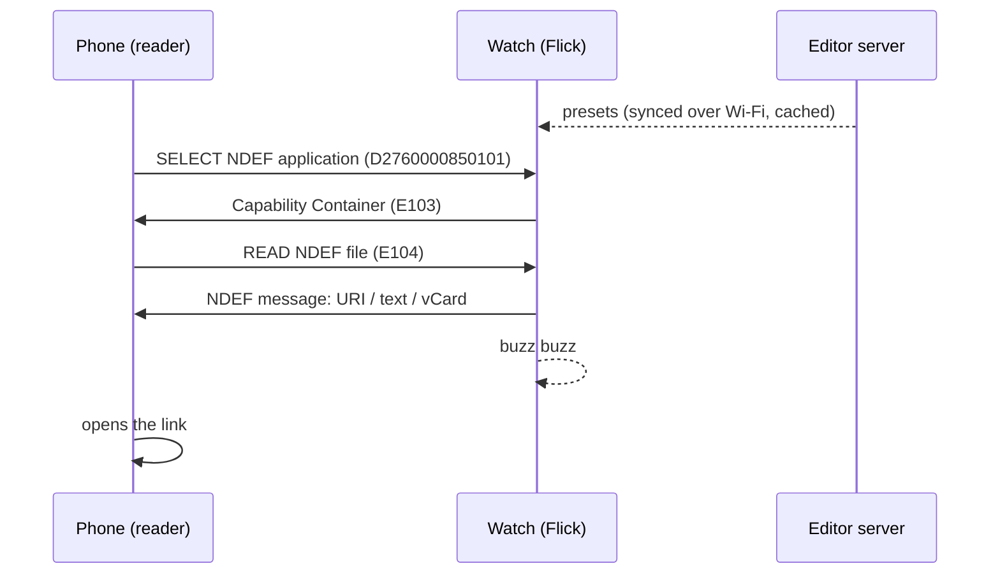

<p align="center">
  
</p>

<p align="center">
  <a href="https://flick.rusty.is-a.dev/"><b>Website</b></a> ·
  <a href="#how-it-works">How it works</a> ·
  <a href="#setup">Setup</a> ·
  <a href="#faq">FAQ</a>
</p>

<p align="center">
  
  
  
  
</p>

---

**Flick** turns a Wear OS watch with NFC into a programmable NFC tag. Pick a
preset on your wrist, hold the watch face to someone's phone, and their phone
opens the link. Your website, a YouTube video, your contact card, or a
"totally normal link" that is absolutely a rickroll.

No app on the other phone. No pairing. No account. Phones already know how to
read NFC tags; Flick just makes your watch pretend to be one.

## ✨ Features

|   |   |
|---|---|
| 🔗 **Links** | Any URL. Android opens it straight away (YouTube links open the YouTube app); iPhones show a banner to tap. |
| 👤 **Contact cards** | Beam a vCard and Android offers to save you as a contact. |
| 💬 **Plain text** | A text record, for when a link is too much. |
| 🧩 **Quick-switch tile** | Your first seven presets as a tile, one swipe from the watch face. |
| 📝 **Browser editor** | Add, rename and reorder presets from any browser on your network. It autosaves. |
| ✈️ **Works offline** | Presets are cached on the watch, so beaming never needs a network. |
| 📳 **Feedback** | The watch buzzes twice once the phone has read the whole tag. |
| 🛡️ **Wallet-safe** | Registered as an `other` category service, so it never gets in the way of tap-to-pay. Turn beaming off and the watch stops answering as a tag at all. |

## 🧠 How it works



Android's **Host Card Emulation** lets an app answer the same APDU commands a
real NFC Forum Type 4 tag would. Flick implements just enough of that tag:

- **`BeamService`** answers `SELECT` for the standard NDEF AID, serves a
  Capability Container and one NDEF file built from the active preset. The
  preset is snapshotted at `SELECT`, so switching mid-read can't tear a message.
- With nothing armed it replies `6A82` (file not found), so the watch simply
  isn't a tag.
- **`server/flick.py`** is a stdlib-only HTTP server with a single-page editor.
  The watch authenticates with its own key and syncs on demand.

```
flick/
├── app/                 Wear OS app (Kotlin, Compose for Wear OS)
│   └── src/main/java/com/rusty/flick/
│       ├── BeamService.kt   the NFC tag
│       ├── Presets.kt       presets, NDEF records, vCards
│       ├── PresetTile.kt    quick-switch tile
│       └── MainActivity.kt  the watch UI
└── server/              preset editor
    ├── flick.py
    ├── editor.html
    └── systemd/flick.service
```

## 📱 What the other phone sees

| Phone | What happens |
|---|---|
| Android, unlocked | The link opens immediately |
| iPhone XS or newer | A banner appears; tap it |
| Contact preset on Android | "Add contact" sheet |
| Contact preset on iPhone | Ignored (iOS doesn't open vCards from tags) |

**Tip:** hold the *watch face* flat against the phone's NFC spot (Android:
middle of the back, iPhone: the top edge). The watch screen needs to be on.

## 🚀 Setup

### 1. Editor server

Any always-on Linux box works. Mine is an old laptop called the Latitude.

```bash
# server/flick.env (gitignored, mode 600)
#   FLICK_KEY=<random 32+ characters>
#   PORT=8480
ssh latitude 'mkdir -p ~/flick ~/.config/systemd/user'
scp server/flick.py server/editor.html server/flick.env latitude:~/flick/
scp server/systemd/flick.service latitude:~/.config/systemd/user/
ssh latitude 'systemctl --user daemon-reload && systemctl --user enable --now flick'
ssh latitude 'sudo ufw allow from 192.168.1.0/24 to any port 8480 proto tcp'
```

Open `http://<server>:8480/#k=<FLICK_KEY>` once. The browser remembers the key,
so afterwards just bookmark `http://<server>:8480/`.

### 2. Watch app

```bash
cp flick.properties.example flick.properties   # set server.key = FLICK_KEY
./gradlew :app:assembleRelease
adb install -r app/build/outputs/apk/release/app-release.apk
adb shell cmd package compile -m speed -f com.rusty.flick
```

Always use the release build; debug builds are painfully slow on a watch.
Make sure NFC is switched on in the watch's settings.

## ❓ FAQ

**Does it work with the app closed?**
Yes. Once a preset is armed, beaming works in the background.

**Another app on my watch uses the same NFC AID.**
Some health apps register the NDEF AID too. Flick asks to be the preferred
service while it's open; on my Galaxy Watch 8 it wins in the background as well.
Check with `adb shell dumpsys nfc | grep 'preferred by foreground'`.

**Why a server at all?**
Typing URLs on a watch is miserable. The editor makes it a paste-and-done job,
and the watch keeps its own copy so the server can be offline.

**Can it read tags too?**
No. It only pretends to be one.

## 📄 License

[AGPL-3.0-or-later](LICENSE). Made by [Rusty](https://rusty.is-a.dev).
